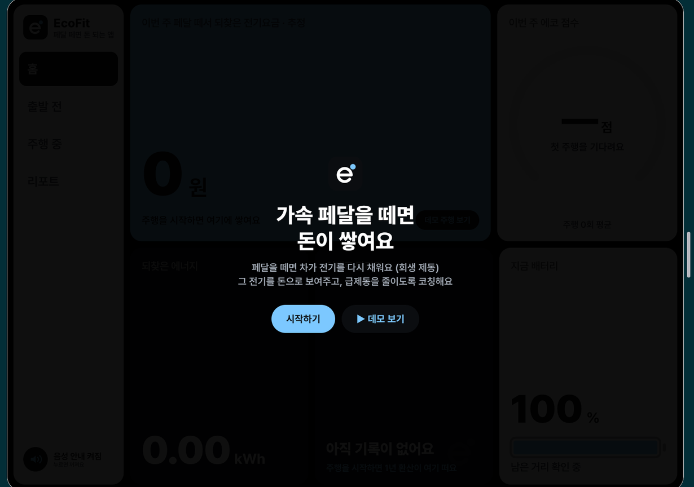
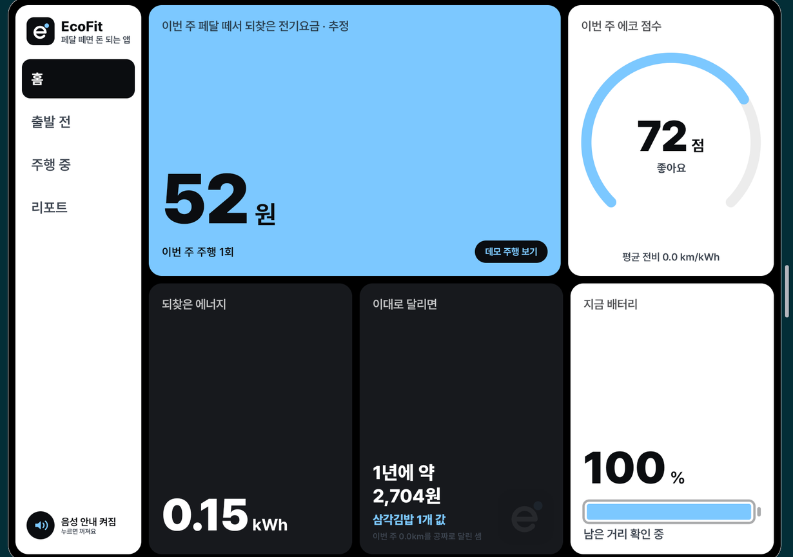
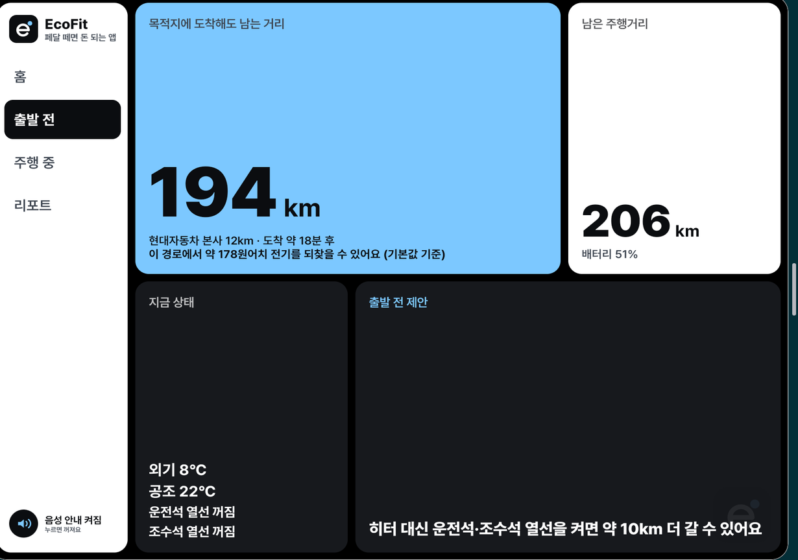
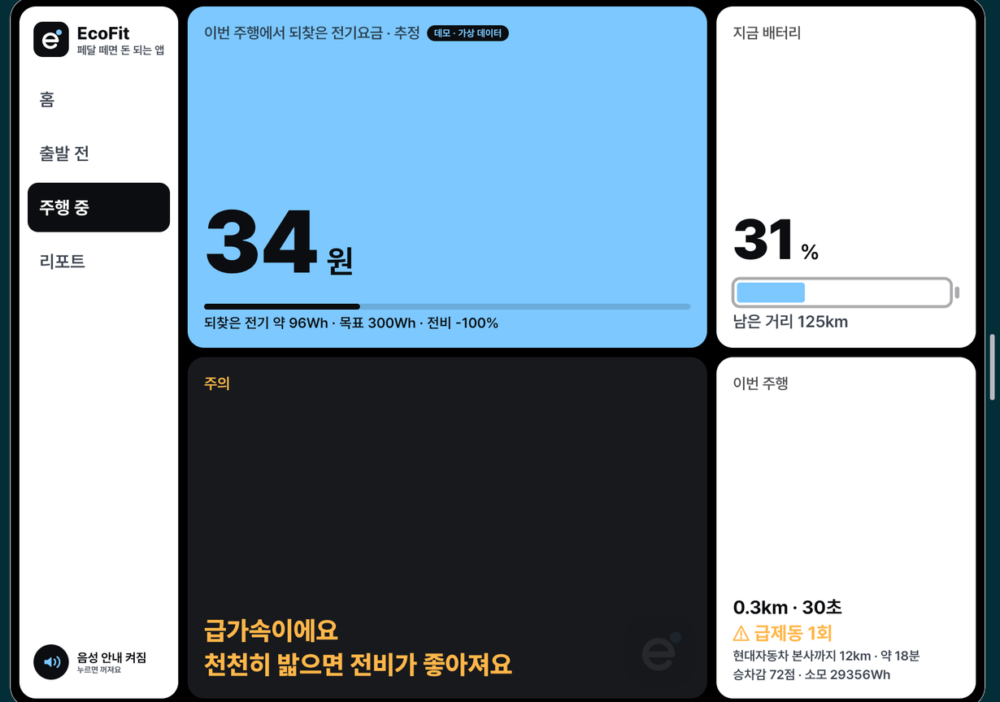
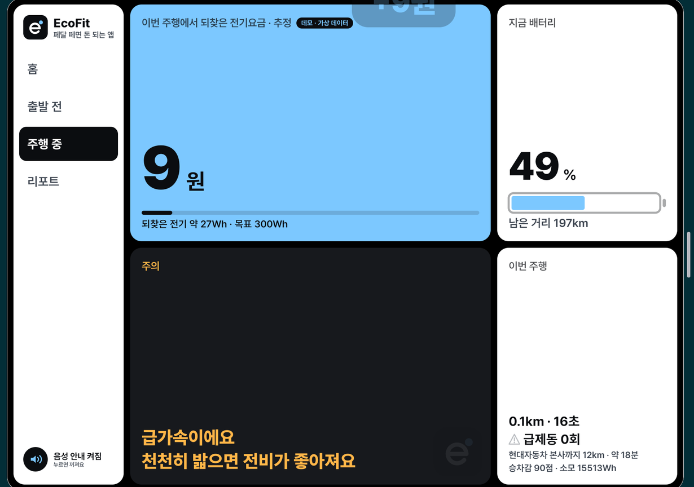
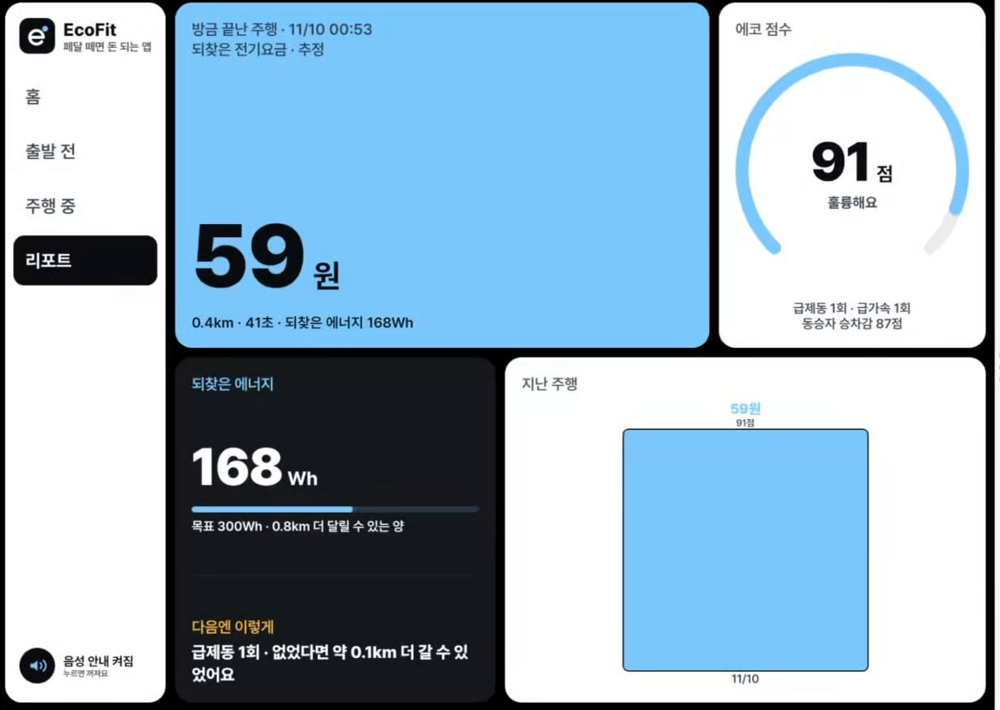

# HMG Pleos App Market 공모전

현대자동차그룹 차량용 앱 개발 공모전(Pleos App Market) 참가 팀 저장소입니다.

> **아이템: EcoFit (REGEN)**
> 아이디어 후보는 [docs/01_ideas/](docs/01_ideas/)에서 제안하고 비교합니다.

## 다운로드

- **팀명**: Back to the Future (백투더퓨처)
- **앱 이름**: EcoFit
- **APK**: [`apk/BackToTheFuture_EcoFit_release.apk`](apk/BackToTheFuture_EcoFit_release.apk) (release 빌드, adb install로 바로 설치 가능)

## 앱 소개

**EcoFit**: 전기차 주행거리를 소프트웨어로 늘리는 EV 운전 코칭 앱

전기차 운전자는 주행할 때마다 목적지까지 배터리가 충분한지, 이번 주행에 비용이 얼마나 들었는지 직접 판단해야 합니다. 계기판은 전비와 배터리 숫자를 보여주지만, 가속 페달을 뗄 때 되찾는 전기(회생 제동)가 얼마인지, 어떤 습관이 전기를 낭비하는지는 알려주지 않습니다.

EcoFit은 Pleos SDK와 AAOS 차량 API로 배터리·차속·기어·공조 데이터를 읽어 출발 전 / 주행 중 / 주행 후에 필요한 정보를 보여줍니다. 가속 페달을 떼서 되찾은 전기(추정 회생량)는 "이번 주 59원어치 전기를 되찾았어요"처럼 전기요금으로 환산하고, 1년 환산액은 치킨·국밥·커피·삼각김밥 같은 생활 단위로도 보여줍니다.

> 금액·에너지·추가 주행거리는 속도 변화로 계산한 **추정치**입니다. 회생 제동은 앱이 없어도 작동하므로, 화면의 금액은 "앱 덕분에 아낀 돈"이 아니라 "되찾은 전기의 요금 환산액"입니다.

> **선점 효과:** Pleos Connect는 아직 EV 차종에 적용 전이지만, 현대자동차그룹은 2030년까지 약 2,000만 대 탑재 계획을 밝혔습니다. EcoFit은 Pleos Vehicle·NaviHelper·TextToSpeech SDK 기반으로 에뮬레이터에서 개발·검증을 마쳤고, 실제 Pleos EV가 출시되면 실차 검증을 거쳐 탑재할 수 있도록 준비했습니다.

### 핵심 기능

- **출발 전 브리핑**: 내비 목적지 거리와 남은 주행거리를 비교해 도착 후 남는 거리를 계산. 30km 미만이면 경고하고, 탭 한 번으로 내비의 "주변 충전소" 화면 연결. 외기 12°C 미만 + 히터 사용 중이면 열선 활용 제안(약 8~10km), 스포츠 모드면 에코 모드 제안
- **주행 중 되찾은 전기요금**: 가속 페달을 떼서 감속하면 "되찾는 중" 배지와 "+7원" 팝업. 목적지까지 남은 거리·시간 표시
- **주행 후 리포트**: 기어 P에서 자동으로 열림. 되찾은 전기요금, 에코 점수, 승차감 점수, "급제동 N번이 없었다면 약 ○km 더" 코칭, 지난 주행 비교 그래프
- **홈(주간)**: 최근 7일 되찾은 전기요금·평균 에코 점수, 1년 환산액(최근 7일 × 52)을 생활 단위로 표시
- **음성 안내(TTS)**: 앱 시작 인사, 출발 전 브리핑, 주행 종료 요약. 주행 중에는 안전을 위해 **급제동·급가속·배터리 20% 미만일 때만** 말하고 금액·칭찬은 화면으로만 표시. 왼쪽 메뉴 버튼으로 켜기/끄기
- **기어 연동**: D/R이면 주행 중 화면, P면 리포트로 자동 전환
- **데모 주행 모드**: 소개 화면 "데모 보기" 또는 홈 "데모 주행 보기"로 실차 없이 가속·회생·급제동이 담긴 약 45초 가상 주행 재생(목적지: 현대자동차 본사 12km). 배터리가 20% 아래로 떨어지면 내비의 "주변 충전소" 화면과 출발 전 목적지 거리까지 자동으로 전환되어 15초간 보여주고 끝남. 화면에 "데모 · 가상 데이터" 배지 표시, 끝나면 실제 차량 데이터로 자동 복귀

### Pleos SDK 활용

- **Vehicle SDK**: EvBattery(배터리·전비·남은 주행거리) · Brake(브레이크 페달 상태) · HVAC(공조) · Seat(열선) · Odometer(주행거리) · DrivingMode(주행 모드). SDK에 없는 속도·기어·외기온은 AAOS CarPropertyManager로 보완
- **NaviHelper SDK**: 목적지까지 거리·도착 예정 시간 수신, 배터리 부족 시 내비 앱의 "주변 충전소" 화면으로 바로 연결
- **TextToSpeech SDK**: ON_DEVICE 모드로 별도 앱 등록 키 없이 음성 안내 적용

## 스크린샷 / 시연

| 첫 실행 | 홈 | 출발 전 |
|------|------|------|
|  |  |  |

| 주행 중 | 데모 주행 | 리포트 |
|------|------|------|
|  |  |  |

> 전체 화면 설명: [docs/03_design/assets/screens/](docs/03_design/assets/screens/) · 기획서 그림: [docs/05_submission/figures/](docs/05_submission/figures/)

> 시연영상: [docs/05_submission/demo-video/](docs/05_submission/demo-video/)

## 실행 방법

1. [`apk/BackToTheFuture_EcoFit_release.apk`](apk/BackToTheFuture_EcoFit_release.apk)를 내려받습니다.
2. AAOS(Android Automotive) 기기 또는 에뮬레이터에 설치합니다.
   ```bash
   adb install apk/BackToTheFuture_EcoFit_release.apk
   ```
3. 앱 목록에서 **EcoFit**을 실행합니다.
4. 첫 실행 시 안내 투어가 뜹니다. 소개 화면의 **"데모 보기"** 또는 홈 화면의 **"데모 주행 보기"** 버튼을 누르면 실제 운전 없이
   약 45초짜리 시나리오로 회생 제동·음성 코칭·리포트까지 전체 흐름을 바로 확인할 수 있습니다.

### 소스에서 직접 빌드하기

```bash
git clone https://github.com/rlawjdtn1887-beep/hmg-pleos-challenge.git
cd hmg-pleos-challenge/app
./gradlew assembleRelease
# 결과물: app/app/build/outputs/apk/release/app-release.apk
```

## 테스트 환경 및 필요한 설정

- **Android Automotive OS(AAOS)** 기기 또는 에뮬레이터가 필요합니다. 일반 폰/태블릿에는
  Vehicle SDK가 요구하는 차량 신호 자체가 없어 설치는 되어도 대부분의 기능이 동작하지 않습니다.
- 개발·테스트는 **Pleos Playground(Pleos Connect v2.1.0)** 차량 신호 에뮬레이터에서 진행했습니다.
  화면 규격은 2,560×1,440(단일 디스플레이, 160dpi)이며, 클러스터·센터 디스플레이가 이 하나의 화면을 좌우로 나눠 씁니다.
- Pleos Playground가 아닌 AAOS 환경에서는 차량 신호(배터리·기어·브레이크 등)가 안 들어와
  일부 수치가 "확인 중"으로 남을 수 있습니다. 이때도 **데모 주행 보기**로 차량 신호 없이
  전체 기능을 테스트할 수 있습니다.
- 음성 안내(TTS)는 Pleos `TextToSpeech` SDK의 ON_DEVICE 모드를 사용해 별도 앱 등록 키가
  필요 없지만, 기기에 Pleos CAAS 컴포넌트가 설치되어 있어야 소리가 납니다.
- 최초 실행 시 위치 정보 권한 팝업이 뜹니다(차량 속도 조회용). 허용해 주세요.

## 팀원

| 역할 | GitHub |
|------|--------|
| 개발 (차량 데이터·SDK 연동, 음성 안내) | [@rlawjdtn1887-beep](https://github.com/rlawjdtn1887-beep) |
| 기획 (기획서·자료 정리·영상) | [@darongki37](https://github.com/darongki37) |
| 개발 (UI/UX 디자인·화면 구현, 데모 모드, 코칭 로직) | [@Chanseo02](https://github.com/Chanseo02) |

## 팀원별 기여

> 각자 맡은 부분과 주요 PR을 적습니다. 주차별 상세 내용은 [docs/progress/](docs/progress/)에 있습니다.

| 이름 | 담당 | 주요 기여 | 주요 PR |
|------|------|-----------|---------|
| @rlawjdtn1887-beep | Pleos SDK 연동 | `PleosVehicleRepository`(EvBattery/Brake/DrivingMode/HVAC/Seat/Odometer) 구현, NaviHelper 연동(출발 전 목적지 거리·도착 시간), 매니페스트 권한 누락 크래시 수정 | [#11](https://github.com/rlawjdtn1887-beep/hmg-pleos-challenge/pull/11), [#15](https://github.com/rlawjdtn1887-beep/hmg-pleos-challenge/pull/15), [#16](https://github.com/rlawjdtn1887-beep/hmg-pleos-challenge/pull/16) |
| @darongki37 | 기획 | 아이디어 기획·검증(가상 고객 100명), 공모전 기획서(접수양식) 작성, 서류 제출 체크리스트, 앱 화면·기획서 그림 정리 | [#8](https://github.com/rlawjdtn1887-beep/hmg-pleos-challenge/pull/8), [#28](https://github.com/rlawjdtn1887-beep/hmg-pleos-challenge/pull/28), [#35](https://github.com/rlawjdtn1887-beep/hmg-pleos-challenge/pull/35) |
| @Chanseo02 | UI/UX·데모·코칭 | EcoFit 프로젝트 초기 세팅(DB/도메인/화면 4개), 타일 기반 UI 디자인, 데모 주행 모드·안내 투어, 회생 금액 팝업, 급제동·급가속 판정과 코칭 문구, 주행 중 화면 정리 | [#10](https://github.com/rlawjdtn1887-beep/hmg-pleos-challenge/pull/10), [#17](https://github.com/rlawjdtn1887-beep/hmg-pleos-challenge/pull/17), [#29](https://github.com/rlawjdtn1887-beep/hmg-pleos-challenge/pull/29), [#30](https://github.com/rlawjdtn1887-beep/hmg-pleos-challenge/pull/30), [#39](https://github.com/rlawjdtn1887-beep/hmg-pleos-challenge/pull/39) |

전체 기여 내역: [Contributors](https://github.com/rlawjdtn1887-beep/hmg-pleos-challenge/graphs/contributors) · [병합된 PR](https://github.com/rlawjdtn1887-beep/hmg-pleos-challenge/pulls?q=is%3Apr+is%3Amerged)

## 폴더 구조

```
.
├── README.md               # 저장소 소개 (이 문서)
├── CONTRIBUTING.md         # 브랜치·커밋·PR 규칙
├── app/                    # Android Studio 프로젝트
├── apk/                    # 제출용 release APK
├── docs/
│   ├── GUIDE.md            # 팀 GitHub 사용 설명서
│   ├── 00_contest-info/    # 공모전 요강·일정·심사기준, 제출 조건 체크리스트
│   ├── 01_ideas/           # 아이디어 후보 (1개당 1파일) + 후보 비교표
│   ├── 02_research/        # UX 리서치·레퍼런스 정리
│   ├── 03_design/          # 화면 흐름·와이어프레임 (이미지는 assets/)
│   ├── 04_roadmap/         # 주차별 로드맵
│   ├── 05_submission/      # 발표자료·시연영상
│   ├── progress/           # 주간 진행 보고 (팀원별 성과)
│   └── meeting-notes/      # 회의록 (YYYY-MM-DD.md)
└── .github/                # 이슈·PR 템플릿
```

## 개발 환경

| 항목 | 내용 |
|------|------|
| 언어 | Kotlin 2.0.0 |
| UI | Jetpack Compose (BOM 2024.04.01), Navigation Compose 2.8.9 |
| 빌드 | AGP 8.8.2, Gradle |
| 로컬 저장소 | Room 2.6.1 |
| 비동기 | Kotlinx Coroutines 1.8.1 |
| Pleos SDK | Vehicle SDK 2.3.2, NaviHelper SDK 3.0.5, TextToSpeech SDK 3.3.1 |
| IDE | Android Studio (차량용 에뮬레이터) |
| 테스트 환경 | Pleos Playground (Pleos Connect v2.1.0) |
| 협업 | GitHub Issues / Projects / Discussions |

## 일정

| 날짜 (KST) | 내용 | 비고 |
|------|------|------|
| 2026.10.21(수) | 공고·접수 시작 | |
| 2026.10.28(수) | 온라인 설명회 | |
| **2026.11.15(일)** | **접수 마감** | |
| 2026.11.23(월) | 1차 서류심사 결과 발표 | |
| 2026.12.03(목)~04(금) | 2차 최종 PT 심사 | 오프라인, 실제 동작 앱 필요 |
| 2026.12.18(금) | 최종 선정 결과 발표 | |

> 세부 내용은 [docs/00_contest-info/](docs/00_contest-info/)의 공모전 요강 참고.

## 협업 방법

> 처음이라면 [팀 GitHub 사용 설명서](docs/GUIDE.md)부터 읽어주세요.

- 할 일은 **Issues**로 만들고 **Projects 보드("공모전 준비")** 에서 관리합니다.
- 자유로운 아이디어 토론은 **Discussions**를 사용합니다.
- 매주 각자 진행 상황을 [docs/progress/](docs/progress/)에 기록합니다.
- 작업 규칙은 [CONTRIBUTING.md](CONTRIBUTING.md)를 참고하세요.
