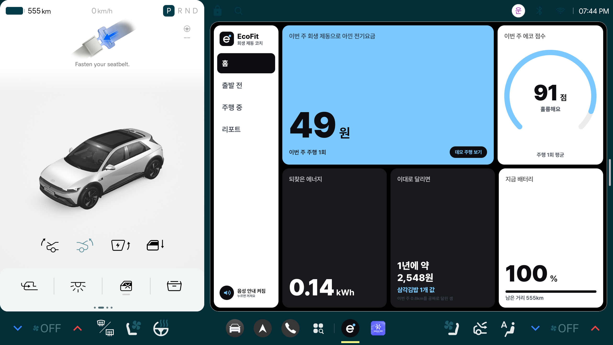
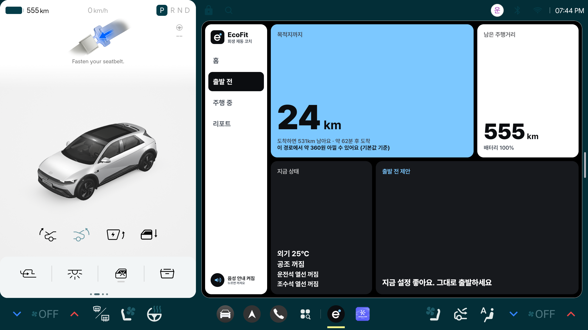
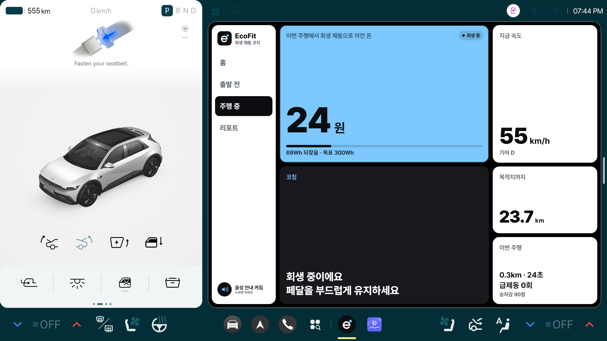

# HMG Pleos App Market 공모전

현대자동차그룹 차량용 앱 개발 공모전(Pleos App Market) 참가 팀 저장소입니다.

> **아이템: EcoFit (REGEN)**
> 아이디어 후보는 [docs/01_ideas/](docs/01_ideas/)에서 제안하고 비교합니다.

## 다운로드

- **팀명**: 백투터퓨쳐
- **앱 이름**: EcoFit
- **APK**: [`apk/백투터퓨쳐_ecofit_release.apk`](apk/백투터퓨쳐_ecofit_release.apk) (release 빌드, adb install로 바로 설치 가능)

## 앱 소개

**EcoFit** — 전기차 주행거리를 소프트웨어로 늘리는 EV 운전 코칭 앱

EV 운전자는 "한 번 충전으로 얼마나 갈 수 있는지" 늘 불안해하지만, 같은 차도 운전 습관에 따라 전비가 20~30% 차이 납니다. 계기판은 전비 숫자만 보여줄 뿐 "어떻게 운전해야 더 가는지"는 알려주지 않습니다.

EcoFit은 Pleos Vehicle SDK로 배터리·회생제동·공조 데이터를 실시간으로 읽어, 출발 전 / 주행 중 / 주행 후 매 순간 행동을 코칭합니다. 그리고 아낀 에너지를 "오늘 3,200원 아꼈어요"처럼 돈과 커피잔 수로 환산해, 전비 개선을 게임처럼 체감하게 만듭니다.

### 핵심 기능

- **실시간 회생 게이지** — 브레이크를 밟을 때마다 회수되는 에너지를 즉시 확인 (실측: 브레이크 1회 0.65kWh / 226원 회수)
- **상황별 코칭** — "외기 12°C 미만이면 히터 대신 시트 열선 켜면 +8km" 같은 구체적 제안
- **돈 환산 리포트** — 아낀 전기를 원화·커피잔·추가 주행거리로 변환해 홈 화면에 노출
- **음성 코칭(TTS)** — 운전 중 화면을 안 봐도 절약 금액·급제동·배터리 부족을 음성으로 안내. 출발 전엔 목적지 브리핑을, 주행 후엔 리포트 요약을 먼저 말해줌
- **출발 전 충전 판단** — 목적지까지 거리와 도착 후 남는 배터리를 미리 계산하고, 부족하면 탭 한 번으로 내비 앱의 "주변 충전소" 화면까지 바로 전환
- **실시간 데모 모드** — 운전 없이도 홈 화면 버튼 한 번으로 약 45초짜리 주행 시나리오를 재생해 전체 기능을 바로 시연

### Pleos SDK 활용

- **Vehicle SDK** — EvBattery(배터리·전비) · Brake(회생제동) · HVAC(공조) · Odometer(주행거리) · DrivingMode. SDK에 없는 속도·기어·외기온은 AAOS CarPropertyManager로 보완
- **NaviHelper SDK** — 목적지까지 거리·도착 예정 시간 수신, 배터리 부족 시 내비 앱의 "주변 충전소" 화면으로 바로 연결
- **TextToSpeech SDK** — ON_DEVICE 모드로 별도 앱 등록 키 없이 음성 코칭을 전 화면에 적용

## 스크린샷 / 시연

| 홈 | 출발 전 | 주행 중 | 리포트 |
|------|------|------|------|
|  |  |  |  |

> 시연영상: [docs/05_submission/demo-video/](docs/05_submission/demo-video/)에 추가 예정

## 실행 방법

1. [`apk/백투터퓨쳐_ecofit_release.apk`](apk/백투터퓨쳐_ecofit_release.apk)를 내려받습니다.
2. AAOS(Android Automotive) 기기 또는 에뮬레이터에 설치합니다.
   ```bash
   adb install apk/백투터퓨쳐_ecofit_release.apk
   ```
3. 앱 목록에서 **EcoFit**을 실행합니다.
4. 첫 실행 시 안내 투어가 뜹니다. 홈 화면의 **"데모 주행 보기"** 버튼을 누르면 실제 운전 없이
   약 45초짜리 시나리오로 회생 제동·음성 코칭·리포트까지 전체 흐름을 바로 확인할 수 있습니다.

### 소스에서 직접 빌드하기

```bash
git clone https://github.com/rlawjdtn1887-beep/hmg-pleos-challenge.git
cd hmg-pleos-challenge/app
./gradlew assembleRelease
# 결과물: app/app/build/outputs/apk/release/app-release.apk
```

## 테스트 환경 및 필요한 설정

- **Android Automotive OS(AAOS)** 기기 또는 에뮬레이터가 필요합니다. 일반 폰/태블릿에는
  Vehicle SDK가 요구하는 차량 신호 자체가 없어 설치는 되어도 대부분의 기능이 동작하지 않습니다.
- 개발·테스트는 **Pleos Playground**(차량 신호 에뮬레이터 포함) 환경에서 진행했습니다.
- Pleos Playground가 아닌 AAOS 환경에서는 차량 신호(배터리·기어·브레이크 등)가 안 들어와
  일부 수치가 "확인 중"으로 남을 수 있습니다 — 이때도 **데모 주행 보기**로 차량 신호 없이
  전체 기능을 테스트할 수 있습니다.
- 음성 안내(TTS)는 Pleos `TextToSpeech` SDK의 ON_DEVICE 모드를 사용해 별도 앱 등록 키가
  필요 없지만, 기기에 Pleos CAAS 컴포넌트가 설치되어 있어야 소리가 납니다.
- 최초 실행 시 차량 속도 조회 권한(`CAR_SPEED`)을 요청하는 팝업이 뜹니다. 허용해 주세요.

## 팀원

| 이름 | 역할 | GitHub |
|------|------|--------|
| 김정수 | 개발 | [@rlawjdtn1887-beep](https://github.com/rlawjdtn1887-beep) |
| 김다희 | 기획, 발표 | [@darongki37](https://github.com/darongki37) |
| 박찬서 | 개발 | [@Chanseo02](https://github.com/Chanseo02) |

## 팀원별 기여

> 각자 맡은 부분과 주요 PR을 적습니다. 주차별 상세 내용은 [docs/progress/](docs/progress/)에 있습니다.

| 이름 | 담당 | 주요 기여 | 주요 PR |
|------|------|-----------|---------|
| @rlawjdtn1887-beep | Pleos SDK 연동 | `PleosVehicleRepository`(EvBattery/Brake/DrivingMode/HVAC/Seat/Odometer) 구현, NaviHelper 연동(출발 전 목적지 거리·도착 시간), 매니페스트 권한 누락 크래시 수정 | [#11](https://github.com/rlawjdtn1887-beep/hmg-pleos-challenge/pull/11), [#15](https://github.com/rlawjdtn1887-beep/hmg-pleos-challenge/pull/15), [#16](https://github.com/rlawjdtn1887-beep/hmg-pleos-challenge/pull/16) |
| @darongki37 | 기획, 발표 | REGEN 아이디어 기획·검증, 공모전 서류·발표자료 준비 | [#8](https://github.com/rlawjdtn1887-beep/hmg-pleos-challenge/pull/8) |
| @Chanseo02 | 앱 구조·UI | EcoFit 프로젝트 초기 세팅(DB/도메인/화면 4개), 타일 기반 UI 리디자인, 회생제동 금액 팝업, 급제동 판정 로직 고도화 | [#10](https://github.com/rlawjdtn1887-beep/hmg-pleos-challenge/pull/10), [#17](https://github.com/rlawjdtn1887-beep/hmg-pleos-challenge/pull/17) |

전체 기여 내역: [Contributors](https://github.com/rlawjdtn1887-beep/hmg-pleos-challenge/graphs/contributors) · [병합된 PR](https://github.com/rlawjdtn1887-beep/hmg-pleos-challenge/pulls?q=is%3Apr+is%3Amerged)

## 폴더 구조

```
.
├── README.md               # 저장소 소개 (이 문서)
├── CONTRIBUTING.md         # 브랜치·커밋·PR 규칙
├── app/                    # Android Studio 프로젝트
├── apk/                    # 제출용 release APK
├── docs/
│   ├── GUIDE.md            # 팀 GitHub 사용 설명서
│   ├── 00_contest-info/    # 공모전 요강·일정·심사기준, 제출 조건 체크리스트
│   ├── 01_ideas/           # 아이디어 후보 (1개당 1파일) + 후보 비교표
│   ├── 02_research/        # UX 리서치·레퍼런스 정리
│   ├── 03_design/          # 화면 흐름·와이어프레임 (이미지는 assets/)
│   ├── 04_roadmap/         # 주차별 로드맵
│   ├── 05_submission/      # 발표자료·시연영상
│   ├── progress/           # 주간 진행 보고 (팀원별 성과)
│   └── meeting-notes/      # 회의록 (YYYY-MM-DD.md)
└── .github/                # 이슈·PR 템플릿
```

## 개발 환경

| 항목 | 내용 |
|------|------|
| 언어 | Kotlin 2.0.0 |
| UI | Jetpack Compose (BOM 2024.04.01), Navigation Compose 2.8.9 |
| 빌드 | AGP 8.8.2, Gradle |
| 로컬 저장소 | Room 2.6.1 |
| 비동기 | Kotlinx Coroutines 1.8.1 |
| Pleos SDK | Vehicle SDK 2.3.2, NaviHelper SDK 3.0.5, TextToSpeech SDK 3.3.1 |
| IDE | Android Studio (차량용 에뮬레이터) |
| 테스트 환경 | Pleos Playground (Pleos Connect v2.1.0) |
| 협업 | GitHub Issues / Projects / Discussions |

## 일정

| 날짜 (KST) | 내용 | 비고 |
|------|------|------|
| 2026.10.21(수) | 공고·접수 시작 | |
| 2026.10.28(수) | 온라인 설명회 | |
| **2026.11.15(일)** | **접수 마감** | |
| 2026.11.23(월) | 1차 서류심사 결과 발표 | |
| 2026.12.03(목)~04(금) | 2차 최종 PT 심사 | 오프라인, 실제 동작 앱 필요 |
| 2026.12.18(금) | 최종 선정 결과 발표 | |

> 세부 내용은 [docs/00_contest-info/](docs/00_contest-info/)의 공모전 요강 참고.

## 협업 방법

> 처음이라면 [팀 GitHub 사용 설명서](docs/GUIDE.md)부터 읽어주세요.

- 할 일은 **Issues**로 만들고 **Projects 보드("공모전 준비")** 에서 관리합니다.
- 자유로운 아이디어 토론은 **Discussions**를 사용합니다.
- 매주 각자 진행 상황을 [docs/progress/](docs/progress/)에 기록합니다.
- 작업 규칙은 [CONTRIBUTING.md](CONTRIBUTING.md)를 참고하세요.
